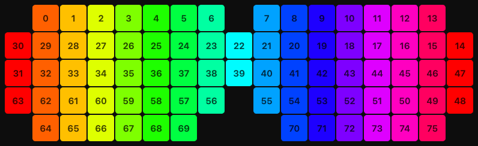
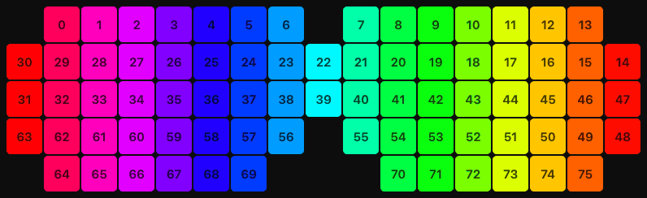
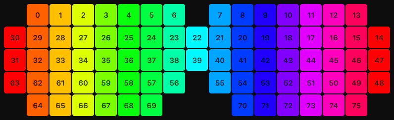
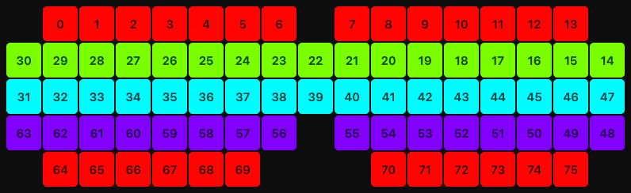
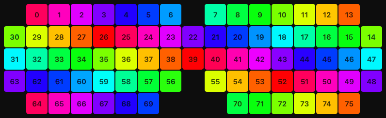
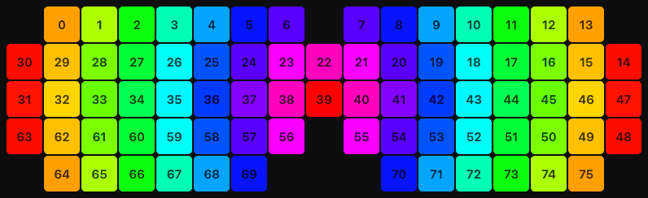
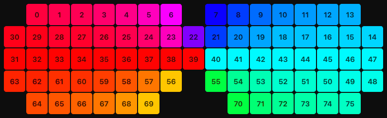

# LED Mapper

Web App: [https://jasoncoon.github.io/led-mapper](https://jasoncoon.github.io/led-mapper)

An online tool to generate and visualize maps for irregular and/or gapped LED layouts, for use with [FastLED], [Pixelblaze] and other libraries.

Heavily inspired by the excellent [FastLED XY Map Generator](https://macetech.github.io/FastLED-XY-Map-Generator) by Garrett Mace of [Macetech] which in turn was inspired by Mark Kriegsman.

The difference with this tool is that instead of generating coordinates for any "gaps", coordinates are only generated for each actual LED. So if you had an irregular/gapped matrix of 128 LEDs in a 16x16 grid, this tool would only create coordinate maps for 128 LEDs instead of 256.  This usually results in lower memory usage, but also generates coordinate maps for radius and angle.

Using [Google Sheets] to create a layout:

https://user-images.githubusercontent.com/3598755/152450649-81ec3f8c-771d-4d9b-a4ab-adffb7c5ac84.mp4


Using LED Mapper to generate maps:

https://user-images.githubusercontent.com/3598755/152450891-5d5a24d5-5bc9-4ac1-b605-20d1e7415367.mp4

---

Here's an example of a serpentine matrix layout (it's deliberately irregular, with gaps):
```
	0	1	2	3	4	5	6		7	8	9	10	11	12	13	
30	29	28	27	26	25	24	23	22	21	20	19	18	17	16	15	14
31	32	33	34	35	36	37	38	39	40	41	42	43	44	45	46	47
63	62	61	60	59	58	57	56		55	54	53	52	51	50	49	48
	64	65	66	67	68	69				70	71	72	73	74	75	
```

---

And the generated [FastLED] coordinate maps:

```c
#define NUM_LEDS 76

byte coordsX[NUM_LEDS] = { 16, 32, 48, 64, 80, 96, 112, 143, 159, 175, 191, 207, 223, 239, 255, 239, 223, 207, 191, 175, 159, 143, 128, 112, 96, 80, 64, 48, 32, 16, 0, 0, 16, 32, 48, 64, 80, 96, 112, 128, 143, 159, 175, 191, 207, 223, 239, 255, 255, 239, 223, 207, 191, 175, 159, 143, 112, 96, 80, 64, 48, 32, 16, 0, 16, 32, 48, 64, 80, 96, 159, 175, 191, 207, 223, 239 };

byte coordsY[NUM_LEDS] = { 0, 0, 0, 0, 0, 0, 0, 0, 0, 0, 0, 0, 0, 0, 64, 64, 64, 64, 64, 64, 64, 64, 64, 64, 64, 64, 64, 64, 64, 64, 64, 128, 128, 128, 128, 128, 128, 128, 128, 128, 128, 128, 128, 128, 128, 128, 128, 128, 191, 191, 191, 191, 191, 191, 191, 191, 191, 191, 191, 191, 191, 191, 191, 191, 255, 255, 255, 255, 255, 255, 255, 255, 255, 255, 255, 255 };

byte angles[NUM_LEDS] = { 11, 13, 15, 19, 24, 32, 45, 83, 96, 104, 109, 112, 114, 116, 122, 122, 121, 119, 118, 114, 109, 96, 64, 32, 19, 13, 10, 8, 7, 6, 5, 0, 0, 0, 0, 0, 0, 0, 0, 0, 128, 128, 128, 128, 128, 128, 128, 128, 133, 133, 134, 136, 137, 141, 146, 159, 223, 236, 242, 245, 247, 248, 249, 250, 244, 242, 240, 236, 231, 223, 159, 151, 146, 143, 141, 139 };

byte radii[NUM_LEDS] = { 230, 200, 170, 141, 114, 89, 71, 71, 89, 114, 141, 170, 200, 230, 255, 224, 192, 161, 130, 100, 71, 45, 32, 45, 71, 100, 130, 161, 192, 224, 255, 253, 221, 190, 158, 127, 95, 63, 32, 0, 32, 63, 95, 127, 158, 190, 221, 253, 255, 224, 192, 161, 130, 100, 71, 45, 45, 71, 100, 130, 161, 192, 224, 255, 230, 200, 170, 141, 114, 89, 89, 114, 141, 170, 200, 230 };
```

---

In addition to [FastLED] maps, a [Pixelblaze] 2D XY map is also generated:

```c
[[1,0],[2,0],[3,0],[4,0],[5,0],[6,0],[7,0],[9,0],[10,0],[11,0],[12,0],[13,0],[14,0],[15,0],[16,1],[15,1],[14,1],[13,1],[12,1],[11,1],[10,1],[9,1],[8,1],[7,1],[6,1],[5,1],[4,1],[3,1],[2,1],[1,1],[0,1],[0,2],[1,2],[2,2],[3,2],[4,2],[5,2],[6,2],[7,2],[8,2],[9,2],[10,2],[11,2],[12,2],[13,2],[14,2],[15,2],[16,2],[16,3],[15,3],[14,3],[13,3],[12,3],[11,3],[10,3],[9,3],[7,3],[6,3],[5,3],[4,3],[3,3],[2,3],[1,3],[0,3],[1,4],[2,4],[3,4],[4,4],[5,4],[6,4],[10,4],[11,4],[12,4],[13,4],[14,4],[15,4]]
```

With the generated maps, the following Arduino code can be used with the [FastLED] library.

---

All of the following examples assume the following structure:
```c
uint8_t speed = 30; // beats per minute (BPM)

for (uint16_t i = 0; i < NUM_PIXELS; i++) {
  leds[i] = COLOR_FUNCTION;
}

FastLED.show();
```

---

For a horizontal rainbow:
```c
  leds[i] = CHSV(coordsX[i]);
```


---

To make it move/scroll:
```c
  leds[i] = CHSV(beat8(speed) - coordsX[i]);
```


---

To go the other direction horizontally:
```c
  leds[i] = CHSV(beat8(speed) + coordsX[i]);
```


---

Vertical:
```c
  leds[i] = CHSV(beat8(speed) + coordsY[i]);
```


---

Diagonal:
```c
  leds[i] = CHSV(beat8(speed) - coordsX[i] + coordsY[i]);
```


---

Radius (expanding outward):
```c
  leds[i] = CHSV(beat8(speed) - radii[i]);
```


---

Angle (rotating clockwise):
```c
  leds[i] = CHSV(beat8(speed) - angles[i]);
```


## Development

Built with [React](https://react.dev), [TypeScript](https://www.typescriptlang.org), [Vite](https://vite.dev) and [Ant Design](https://ant.design).

```sh
npm install
npm run dev        # http://localhost:5173
npm test           # type-check + lint + unit tests
```

Every push to `main` is tested, built and deployed to GitHub Pages by
[.github/workflows/deploy.yml](.github/workflows/deploy.yml) (Settings → Pages → Source: GitHub Actions).
`npm run build` builds locally to `dist/` (not committed); `npm run preview` serves it.

[FastLED]: https://github.com/FastLED/FastLED
[Pixelblaze]: https://www.bhencke.com/pixelblaze
[Google Sheets]: https://sheets.google.com
[Macetech]: https://macetech.com
